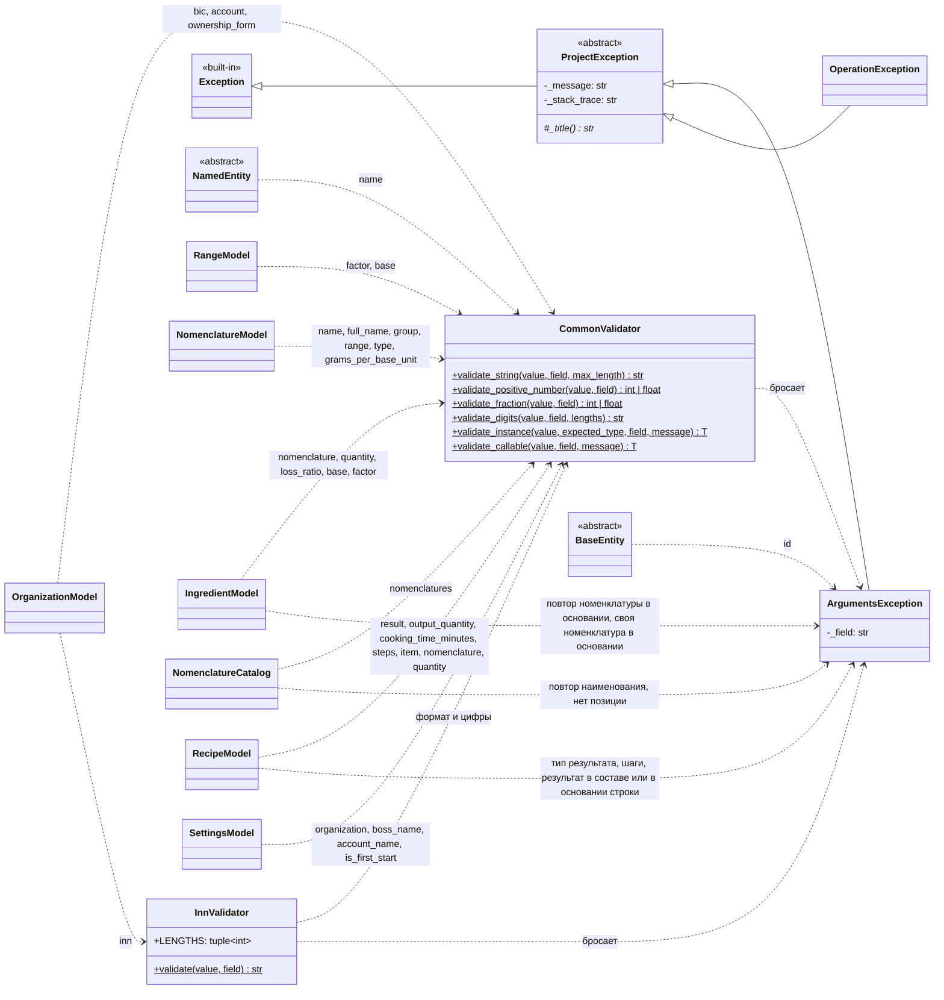
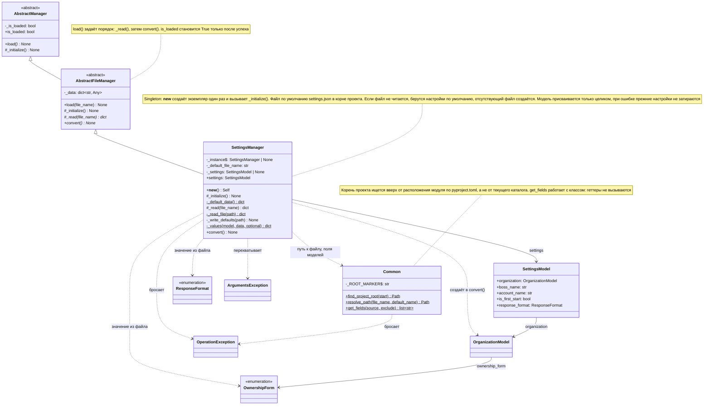
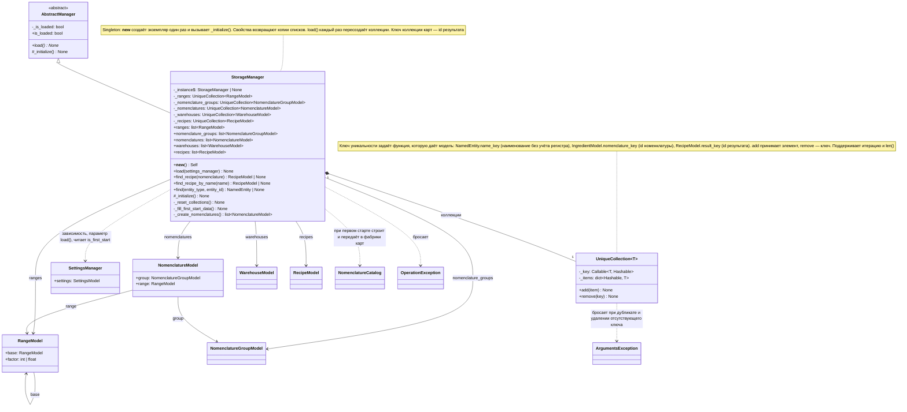
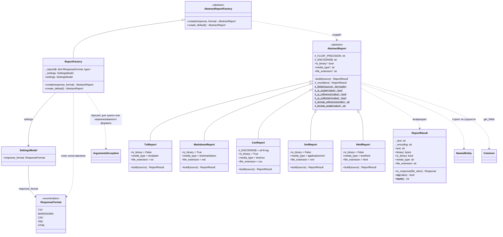
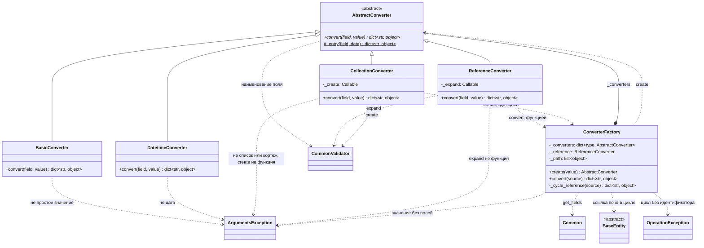

# Диаграммы классов

Диаграммы описывают реализованный код в `Src/`, а не планы из `Docs/DomainEntities.md`.
При добавлении, переименовании или удалении класса обновляйте соответствующую диаграмму.
Mermaid отображается в GitHub и в IDE с поддержкой Markdown.

## Модели

Все модели лежат в `Src/Models/`, базовые классы — в `Src/Core/`.
Стрелка с пустым треугольником — наследование, обычная стрелка — хранимая ссылка на другую модель.

```mermaid
classDiagram
    direction TB

    class BaseEntity {
        <<abstract>>
        +id: UUID
    }

    note for BaseEntity "Равенство и хэш определяются по id и типу"

    class NamedEntity {
        <<abstract>>
        +name: str
        +name_key() str
    }

    note for NamedEntity "name_key — ключ уникальности по наименованию без учёта регистра, функция ключа UniqueCollection"

    class RangeModel {
        +base: RangeModel
        +factor: int | float
        +is_base: bool
        +create_kilogram()$ RangeModel
        +create_liter()$ RangeModel
        +create_piece()$ RangeModel
    }

    class NomenclatureModel {
        +NAME_MAX_LENGTH = 50
        +FULL_NAME_MAX_LENGTH = 255
        +full_name: str
        +group: NomenclatureGroupModel
        +range: RangeModel
        +type: NomenclatureType
        +grams_per_base_unit: int | float
        +create_raw_material(name, full_name, group, range, grams_per_base_unit)$ NomenclatureModel
        +create_semi_finished(name, full_name, group, range, grams_per_base_unit)$ NomenclatureModel
        +create_dish(name, full_name, group, range, grams_per_base_unit)$ NomenclatureModel
        +create_packaging(name, full_name, group, range, grams_per_base_unit)$ NomenclatureModel
    }

    class NomenclatureType {
        <<enumeration>>
        RAW_MATERIAL
        PRODUCT
        SEMI_FINISHED
        DISH
        PACKAGING
    }

    class IngredientModel {
        +nomenclature: NomenclatureModel
        +quantity: int | float
        +loss_ratio: int | float
        +base: tuple~IngredientModel~
        +gross_weight: float
        +net_weight: float
        +scaled(factor) IngredientModel
        +contains(nomenclature) bool
        +nomenclature_key() UUID
    }

    note for IngredientModel "Строка состава карты, без id (паттерн Компоновщик в одном классе). Пустое base — сырьё или упаковка, вес из количества и grams_per_base_unit. Непустое base — полуфабрикат: снимок карты под это количество, вес — сумма base. base задаётся в конструкторе и копируется, смена quantity масштабирует его. Веса вычисляются при каждом обращении. О картах не знает"

    class NomenclatureCatalog {
        +get(name) NomenclatureModel
    }

    note for NomenclatureCatalog "Справочник номенклатуры: поиск по наименованию. Не владеет позициями, возвращает те же экземпляры. Повтор наименования отвергается"

    class RecipeModel {
        +RESULT_TYPES: frozenset~NomenclatureType~
        +result: NomenclatureModel
        +output_quantity: int | float
        +cooking_time_minutes: int | float
        +steps: list~str~
        +items: list~IngredientModel~
        +gross_weight: float
        +net_weight: float
        +gross_weight_for(output_quantity) float
        +net_weight_for(output_quantity) float
        +add_item(item) None
        +remove_item(nomenclature) None
        +as_ingredient(quantity, loss_ratio) IngredientModel
        +result_key() UUID
        +create_beef_bouillon(catalog)$ RecipeModel
        +create_boiled_beef(catalog)$ RecipeModel
        +create_beet_fry(catalog)$ RecipeModel
        +create_borscht(catalog, bouillon?, boiled_beef?, beet_fry?)$ RecipeModel
    }

    note for RecipeModel "Результат (полуфабрикат или блюдо) только для чтения. Ингредиенты состава уникальны по номенклатуре. Веса брутто и нетто — сумма по ингредиентам, рекурсия получается сама. as_ingredient собирает снимок карты для состава другой карты. add_item отвергает строку, в дереве которой есть результат карты. gross_weight_for и net_weight_for масштабируют веса под заданный выход. Фабрики карт принимают NomenclatureCatalog. create_borscht сам создаёт не переданные карты полуфабрикатов, ошибки не скрывает"

    class NomenclatureGroupModel {
        +create_meat()$ NomenclatureGroupModel
        +create_dairy()$ NomenclatureGroupModel
        +create_vegetables()$ NomenclatureGroupModel
        +create_grocery()$ NomenclatureGroupModel
        +create_semi_finished()$ NomenclatureGroupModel
        +create_dishes()$ NomenclatureGroupModel
        +create_packaging()$ NomenclatureGroupModel
    }

    class WarehouseModel {
        +create_restaurant_warehouse()$ WarehouseModel
        +create_workshop_warehouse()$ WarehouseModel
    }

    class SettingsModel {
        +organization: OrganizationModel
        +boss_name: str
        +account_name: str
        +is_first_start: bool
        +response_format: ResponseFormat
    }

    class OrganizationModel {
        +BIC_LENGTH = 9
        +ACCOUNT_LENGTH = 20
        +inn: str
        +bic: str
        +account: str
        +ownership_form: OwnershipForm
    }

    class OwnershipForm {
        <<enumeration>>
        LLC
        JSC
        PJSC
        SOLE_PROPRIETOR
    }

    class ResponseFormat {
        <<enumeration>>
    }

    BaseEntity <|-- NamedEntity
    BaseEntity <|-- SettingsModel
    NamedEntity <|-- RangeModel
    NamedEntity <|-- NomenclatureModel
    NamedEntity <|-- NomenclatureGroupModel
    NamedEntity <|-- WarehouseModel
    NamedEntity <|-- OrganizationModel
    NamedEntity <|-- RecipeModel

    NomenclatureModel --> NomenclatureGroupModel : group
    NomenclatureModel --> RangeModel : range
    NomenclatureModel --> NomenclatureType : type
    IngredientModel --> NomenclatureModel : nomenclature
    IngredientModel "1" *-- "0..*" IngredientModel : base
    RecipeModel --> NomenclatureModel : result
    RecipeModel "1" *-- "*" IngredientModel : items
    RecipeModel ..> IngredientModel : as_ingredient
    NomenclatureCatalog o-- NomenclatureModel : items
    RecipeModel ..> NomenclatureCatalog : фабрики карт
    RangeModel --> RangeModel : base
    OrganizationModel --> OwnershipForm : ownership_form
    SettingsModel --> OrganizationModel : organization
    SettingsModel --> ResponseFormat : response_format
```

## Рецепты

Модели технологических карт (п. 2.1 и 2.5 ТЗ) и то, как они связаны с номенклатурой и хранилищем.
Те же классы показаны на общей диаграмме выше, здесь оставлено только относящееся к рецептам.

- Карта (`RecipeModel`) получает одну номенклатуру-результат: полуфабрикат или блюдо.
- Состав — ингредиенты `IngredientModel` без собственного `id`: внутри карты строку определяет номенклатура.
  Строка хранит количество в базовой единице номенклатуры, долю потерь и основание `base` — состав этого количества.
  «Компоновщик» в одном классе: пустое `base` — сырьё или упаковка, непустое — полуфабрикат или блюдо со своей картой.
- Вес сырья: брутто = `quantity * grams_per_base_unit`, нетто = брутто * (1 − `loss_ratio`).
- Вес составной строки: брутто = сумма брутто `base`, нетто = сумма нетто `base` * (1 − `loss_ratio`).
  Вес карты — сумма по строкам, вычисляется при каждом обращении.
- Полуфабрикат входит в карту снимком: `recipe.as_ingredient(quantity, loss_ratio)` копирует состав карты,
  масштабированный на `quantity / output_quantity`. Основание — производные данные, источник истины — карта
  полуфабриката (`StorageManager.find_recipe()` по номенклатуре строки). Правка карты уже собранные строки не меняет,
  каскадную пересборку в будущем возьмёт на себя наблюдатель. Ингредиент о картах не знает, цикла импортов нет.
- Циклы по ссылкам невозможны: `base` задаётся в конструкторе и копируется. `RecipeModel.add_item` отвергает строку,
  в дереве которой есть результат карты (`IngredientModel.contains`). Проверка надёжна, пока снимки свежие:
  устаревший снимок может не увидеть цепочку, добавленную после его сборки.
- Фабрики `create_*` собирают карты из `Recipes.md` по справочнику `NomenclatureCatalog` (поиск номенклатуры по наименованию).

```mermaid
classDiagram
    direction LR

    class NomenclatureType {
        <<enumeration>>
        RAW_MATERIAL
        PRODUCT
        SEMI_FINISHED
        DISH
        PACKAGING
    }

    class NomenclatureModel {
        +type: NomenclatureType
        +grams_per_base_unit: int | float
    }

    class IngredientModel {
        +nomenclature: NomenclatureModel
        +quantity: int | float
        +loss_ratio: int | float
        +base: tuple~IngredientModel~
        +gross_weight: float
        +net_weight: float
        +scaled(factor) IngredientModel
        +contains(nomenclature) bool
        +nomenclature_key() UUID
    }

    note for IngredientModel "Строка состава, без id. loss_ratio от 0 включительно до 1 не включая. Пустое base — сырьё, непустое — снимок карты полуфабриката. contains нужен карте, чтобы не включить снимок самой себя"

    class NomenclatureCatalog {
        +get(name) NomenclatureModel
    }

    note for NomenclatureCatalog "Справочник номенклатуры: поиск по наименованию. Не владеет позициями, возвращает те же экземпляры. Повтор наименования отвергается"

    class RecipeModel {
        +RESULT_TYPES: frozenset~NomenclatureType~
        +result: NomenclatureModel
        +output_quantity: int | float
        +cooking_time_minutes: int | float
        +steps: list~str~
        +items: list~IngredientModel~
        +gross_weight: float
        +net_weight: float
        +gross_weight_for(output_quantity) float
        +net_weight_for(output_quantity) float
        +add_item(item) None
        +remove_item(nomenclature) None
        +as_ingredient(quantity, loss_ratio) IngredientModel
        +result_key() UUID
        +create_beef_bouillon(catalog)$ RecipeModel
        +create_boiled_beef(catalog)$ RecipeModel
        +create_beet_fry(catalog)$ RecipeModel
        +create_borscht(catalog, bouillon?, boiled_beef?, beet_fry?)$ RecipeModel
    }

    note for RecipeModel "Результат — только SEMI_FINISHED или DISH, задаётся в конструкторе. Брутто и нетто — сумма по элементам. gross_weight_for и net_weight_for масштабируют веса под заданный объём. Результат не может входить в состав своей карты, в том числе в основание строки. as_ingredient масштабирует состав под количество строки"

    class UniqueCollection~T~ {
        +add(item) None
        +remove(key) None
    }

    note for UniqueCollection "Функцию ключа даёт сама модель: IngredientModel.nomenclature_key (id номенклатуры), RecipeModel.result_key (id результата), NamedEntity.name_key (наименование)"

    class StorageManager {
        +recipes: list~RecipeModel~
        +find_recipe(nomenclature) RecipeModel | None
        +find_recipe_by_name(name) RecipeModel | None
        +find(entity_type, entity_id) NamedEntity | None
    }

    note for StorageManager "Одна карта на номенклатуру-результат. Включение снимка самой себя отвергает карта при добавлении строки, хранилище его не проверяет"

    class ArgumentsException

    NomenclatureModel --> NomenclatureType : type
    IngredientModel --> NomenclatureModel : nomenclature
    IngredientModel "1" *-- "0..*" IngredientModel : base
    RecipeModel --> NomenclatureModel : result
    RecipeModel "1" *-- "*" IngredientModel : items
    RecipeModel ..> IngredientModel : as_ingredient
    NomenclatureCatalog o-- NomenclatureModel : items
    RecipeModel ..> NomenclatureCatalog : фабрики карт
    RecipeModel *-- UniqueCollection : items
    StorageManager *-- UniqueCollection : recipes
    StorageManager --> RecipeModel : recipes
    RecipeModel ..> ArgumentsException : нет номенклатуры в справочнике, дубликат, результат в составе или в основании строки
    StorageManager ..> ArgumentsException : вторая карта на результат
```

Пример составной карты: «Борщ с говядиной» (блюдо) включает полуфабрикаты «Бульон костный говяжий»,
«Говядина отварная», «Зажарка свекольная» и упаковку «Контейнер для супа 500 мл». Каждый полуфабрикат входит
снимком своей карты (`as_ingredient`) с количеством и потерями строки, а карты полуфабрикатов состоят только из сырья,
поэтому циклов в начальных данных нет.

## Проверки и ошибки

Все проверки бросают `ArgumentsException`. Модели вызывают валидаторы из сеттеров.
`OperationException` бросают менеджеры, когда операция не удалась при корректных аргументах
(файл недоступен, настройки не загружены), см. раздел «Менеджеры».

## Менеджеры

Менеджеры лежат в `Src/Logics/`, базовые классы и `UniqueCollection` — в `Src/Core/`.
`AbstractManager` задаёт только общий контракт: флаг `is_loaded` и абстрактный `load()`.
`AbstractFileManager` добавляет работу с файлами: базовый `load(file_name)` сначала вызывает `_read()`,
затем `convert()`. Наследники реализуют `_read()` и `convert()`, но не переопределяют `load()`.
Менеджер без файлов (`StorageManager`) наследует `AbstractManager` напрямую и реализует `load()` сам.
Менеджер — Singleton: каждый конкретный класс реализует это в своём `__new__` и хранит экземпляр
в собственном `_instance`. Базовые классы Singleton не реализуют.
Пунктирная стрелка — зависимость (использует или бросает), стрелка с ромбом — владение.

### SettingsManager

Читает `settings.json` и собирает из него `SettingsModel`. Ошибки модели (`ArgumentsException`) превращает
в `OperationException`, чтобы вызывающий код ловил одно исключение.

### StorageManager

Хранит доменные модели в пяти коллекциях без дубликатов. При первом запуске (`is_first_start` в настройках)
`load()` наполняет их начальными данными через фабричные методы моделей: 5 единиц измерения, 7 групп,
24 номенклатуры, 2 склада и 4 технологические карты из `Recipes.md`.
Номенклатура ссылается на те же объекты единиц и групп, что лежат в коллекциях, а карты — на те же объекты номенклатуры, а не на копии.
Циклы включений хранилище не проверяет: снимок самой себя отвергает карта при добавлении строки (`RecipeModel.add_item`).
Карту полуфабриката находит `find_recipe()` по номенклатуре-результату, на одну позицию допускается одна карта.
По наименованию карту ищет `find_recipe_by_name()` (без учёта регистра), её использует API отчёта.
Сущность по типу (`EntityType`: номенклатура, единица измерения, карта) и коду ищет `find()` перебором коллекции этого типа.
Хранилище зависит от менеджера настроек: `load(settings_manager)` принимает его параметром, по умолчанию берёт
единственный `SettingsManager`. Настройки должны быть загружены до `StorageManager.load()`, сам `load()` их не загружает.
С файлами `StorageManager` не работает, поэтому наследует `AbstractManager`, а не `AbstractFileManager`.

## Отчёты

Отчёт формирует по сущности результат в одном из форматов (`ResponseFormat`). У каждого формата свой класс отчёта
со своей реализацией `build()` и своими признаками выдачи (`is_binary`, `media_type`, `file_extension`).
Клиент получает отчёт от фабрики по формату и работает только с абстракцией `AbstractReport`
(паттерн «Абстрактная фабрика»). Абстракции лежат в `Src/Core/`, отчёты и фабрика — в `Src/Logics/`,
результат `ReportResult` — в `Src/Dtos/`.

Фабрика хранит настройки (`SettingsModel`): `create(response_format)` создаёт отчёт явно указанного формата,
`create_default()` — формата из `SettingsModel.response_format`. Новый формат подключается строкой в `_reports`.

Общие для всех форматов правила обхода заданы в `AbstractReport`: поля — публичные свойства (`Common.get_fields`),
вложенная сущность с наименованием выводится ссылкой (наименование и код), списки — поэлементно,
остальные объекты раскрываются по дереву «Компоновщика» (`RecipeModel.items`, `IngredientModel.base`).
Так не зацикливается `RangeModel.base` у базовой единицы, а все форматы выводят один и тот же состав данных.

Результат — объект-значение: без идентификатора, неизменяем, равенство по содержимому и способу выдачи.
Он один на все форматы: формат знает про себя отчёт и передаёт результату MIME-тип, расширение и признак
файла (`AbstractReport._result()`). `is_binary` подсказывает API, отдавать ли результат файлом на скачивание
(Markdown, CSV) или текстом (TXT, XML, HTML). Сам результат собирает HTTP-ответ (`to_response()`), поэтому
`fastapi` нужен только в `Src/Dtos/` и `Src/main.py`, а не в ядре. CSV кодируется с меткой UTF-8 для Excel
(`CsvReport._ENCODING`). Компромисс: `AbstractReport` из `Src/Core/` импортирует `ReportResult` из `Src/Dtos/`.

## Конвертация

Конвертеры превращают объект во вложенный словарь «наименование поля — данные поля», который `json.dumps`
записывает без настроек. Это основа сериализации: модель или всё хранилище сначала становится словарём,
а словарь — JSON. Абстракция лежит в `Src/Core/`, конвертеры и фабрика — в `Src/Logics/`.

Клиент вызывает только `ConverterFactory.convert(source)`. Для каждого поля объекта (`Common.get_fields`)
фабрика выбирает конвертер по типу значения (`create()`) и объединяет словари `{поле: данные}`, которые тот вернул.
Выбор идёт по сопоставлению `_converters` с обходом MRO типа, без цепочки `isinstance`:

| Тип значения                                   | Конвертер             | Данные                                  |
|------------------------------------------------|-----------------------|-----------------------------------------|
| `str`, `int`, `float`, `bool`, `None`          | `BasicConverter`      | как есть                                |
| `Enum`, `UUID`                                 | `BasicConverter`      | значение перечисления, строка кода      |
| `date`, `datetime`                             | `DatetimeConverter`   | строка ISO 8601                         |
| `list`, `tuple`                                | `CollectionConverter` | список данных элементов                 |
| остальные объекты (`object`): модели и т. п.   | `ReferenceConverter`  | вложенный словарь полей                 |

Рекурсия: `ReferenceConverter` возвращает вложенный объект в `ConverterFactory.convert`, а `CollectionConverter`
выбирает конвертер элемента через `ConverterFactory.create`. Фабрика передаёт им свои методы функциями,
поэтому конвертеры не зависят от её класса и цикла импортов нет.

Защита от циклов: фабрика помнит путь от корня до текущего объекта. Объект, который уже есть на пути
(у базовой единицы `RangeModel.base` — она сама), записывается ссылкой `{"id": ...}`. Цикл через объект
без идентификатора — `OperationException`. Общая модель без цикла (одна группа у разных позиций) раскрывается
везде целиком. Поля — все публичные свойства, поэтому вычисляемые (`is_base`, веса) тоже попадают в словарь.

