# Проектирование системы логирования (диалог с ИИ-тренером)

Проект: автоматизация сети ресторанов «Ромашка» — ветка `hw10-logger`.

---

### Студент · 26.11.2026 13:00

/learning-mode-patterns Смотри, нам нужно будет выполнить домашнее задание из файла docs homework. Оно заключается в том, что нам нужно сделать систему логирования и сделать ее на основе паттерна наблюдатель. Сам по себе паттерн-наблюдатель мы проходили на паре, преподаватель его залил свой гид. Ссылку на гид я тебе указал. Модель Логера мы как бы тоже строили, но я не уверен, что она была правильной, поэтому мы сделаем ее как бы сначала и будем ориентироваться на то, что потом она будет использоваться на паттерне наблюдателя. Вот.

---

### ИИ-тренер · 26.11.2026 13:01

Посмотрел `Docs/.homework.md` и свежий коммит преподавателя с Наблюдателем (`abstract_observabile`, `event_type`, `observer`).

Общая рамка задачи:

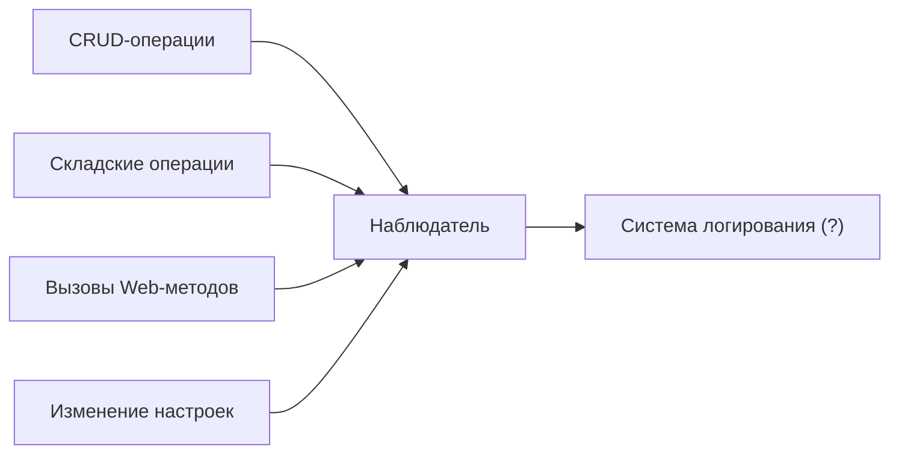

*(Кстати, в репозитории преподавателя ещё лежит письмо `_docs/20261123.md` с требованием отдавать логи через API с фильтрацией/сортировкой и выгрузкой — маякни, если это тоже берём в работу или идём строго по `Docs/.homework.md`.)*

Давай начнём с **модели логирования**, как ты предложил. Набросай из головы (словами или списком, без кода):

1. Какие сущности/классы тут вообще нужны (например: что описывает одну запись лога, кто эти записи хранит или пишет, нужны ли перечисления)?
2. Какие поля должны быть у одной записи лога и где в иерархии нашего проекта (`AbstractModel` / `BaseEntity` / отдельный класс) ей место, если потом логи могут понадобиться в конвертерах, фильтрах или БД?

---

### Студент · 26.11.2026 13:07

наша текущая реализация должна будет отвечать еще и тербованиям из _docs/20261123.md

---

### ИИ-тренер · 26.11.2026 13:07

Отлично, тогда держим в голове **оба** источника требований — `Docs/.homework.md` и `_docs/20261123.md`:

- **Что логируем** (через Наблюдатель): CRUD-операции, складские операции, вызовы Web-методов, изменение настроек.
- **Формат записи**: `Период | Название подсистемы | Тип сообщения (ERROR / INFO / DEBUG) | Сообщение`.
- **Выдача через API (+ Swagger и тесты)**:
  - JSON с **фильтрацией** и **сортировкой**;
  - опционально выгрузка в формате `TXT` (файл), `CSV` (файл), `MARKDOWN` (текст в браузере).
- **Для PR**: приложить скриншоты/файлы с результатами логирования.

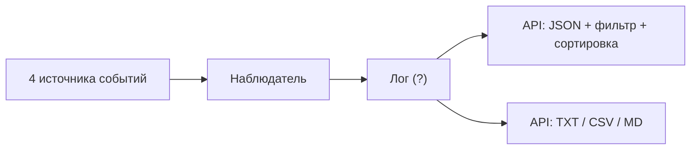

Начинаем с **модели записи лога** — предложи свой вариант из головы (можно списком, без кода):

1. Какие классы и перечисления нужны для самой модели лога?
2. Какие поля будут у одной записи и от какого базового класса нашего проекта она должна наследоваться (с учётом того, что потом её придётся фильтровать, сортировать и отдавать в JSON/отчёты)?

---

### Студент · 26.11.2026 13:14

Так, ну, я так понимаю, что у нас прежде всего должен появиться Е нам класс с типом сообщения error, info или debug. Затем у нас должна появиться модель лого, в которой будет поле периода, поле названия подсистемы. Соответственно, указывается тип сообщения из вот этого ENAM класса нового и само по себе сообщение. Потом должен быть какой-то класс, вроде Logger Manager, ну вот этот какой-то слой сервиса, который будет этими логами управлять, соответственно, как условный сторож-менеджер. И внутри себя он будет иметь правила по записи этих логов. само по себе хранение этих логов.

---

### ИИ-тренер · 26.11.2026 13:14

Хорошая основа. Вот что у тебя уже сложилось:

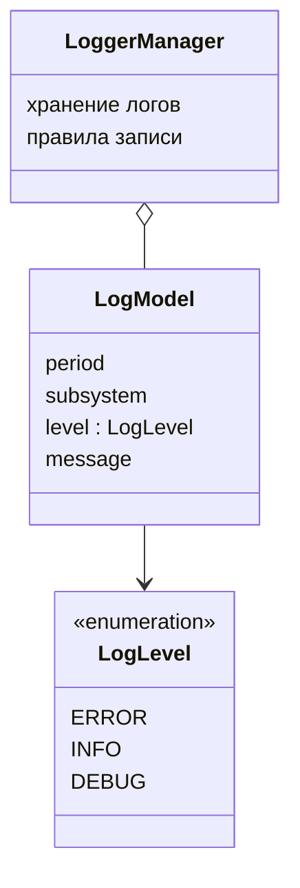

**Что работает хорошо:**
- **`Enum` для уровня (`ERROR / INFO / DEBUG`)** — защищает от опечаток и из коробки дружит с твоими `ConverterFactory` и `Prototype` (они сами берут `.value`).
- **Отдельная модель записи лога** — вместо «сырых строк» у тебя структурированный объект, который потом легко фильтровать, сортировать и выгружать.
- **Вынос логов из `StorageManager` в отдельный менеджер** — логи не загрязняют доменное хранилище и обратный индекс ссылок.

Теперь посмотрим, где в этой схеме есть **два слабых места** на реальных сценариях:

1. **Контракт самой модели `LogModel`:**
   - Что будет, если кто-то сможет изменить уже записанный лог (`entry.message = ...`), и стоит ли наследовать его от `BaseEntity` / `AbstractModel` (сравни со своей `TransactionModel`) или оставить отдельным классом/DTO?
   - И по полю **`subsystem`**: если оно просто `str`, что случится при фильтрации по подсистеме, если в одном месте напишут `"Web"`, а в другом `"web_api"`?

2. **Смешение обязанностей в `LoggerManager`:**
   - Сейчас он отвечает сразу и за *правила обработки/записи*, и за *способ хранения*.
   - **Сценарий:** завтра логи нужно писать одновременно в память (для API) и в файл на диске (для PR / аудита), а позже — переключить хранение на SQLite. Что в этом случае придётся переписывать в `LoggerManager`, и как в тестах проверить логирование, не засоряя диск?

Как бы ты доработал модель записи и разграничил обязанности вокруг `LoggerManager`?

---

### Студент · 26.11.2026 13:17

Так, ну logmodel нужно будет наследовать от BaseEntity, чтобы оставить возможность фильтрации. И насчет поля Subsystem, возможно, тоже стоит ввести какой-то Enam класс, чтобы исключить вот это разное написание строк. Насчет смешения обязанностей получается... Логер-менеджер тогда должен только иметь способы, соответственно, хранения, а сами правила обработки и всего этого, они должны, наверное, уже реализовываться на уровне наблюдателя, на уровне того, как мы вот это будем делать.

---

### ИИ-тренер · 26.11.2026 13:17

Отличное разделение — ты вынес правила обработки событий наружу, а за `LoggerManager` оставил только хранение.

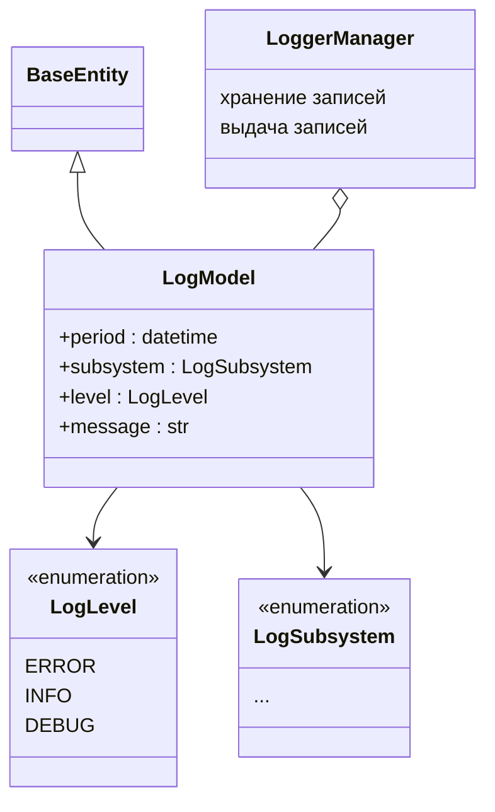

**Две короткие пометки по модели:**
- **`LogSubsystem` как `Enum`** — верный ход: в коде и при фильтрации не будет разнобоя вроде `"Web"` vs `"web_api"`.
- **`BaseEntity` для `LogModel`** — хороший выбор на вырост: даёт `id`, `model_type` и `from_dict` (для JSON и будущей SQLite), как у `TransactionModel`. Только уточню: самой фильтрации (`Prototype`) и `ConverterFactory` класс `BaseEntity` не обязателен — им достаточно публичных `@property` (и лучше без сеттеров, чтобы уже записанный лог нельзя было подменить).

---

Теперь переходим к связке **Наблюдатель ↔ Логгер**.

Представь два сценария:
- События прилетают из 4 разных мест: CRUD (`EntityService`), склад (`StorageManager`), Web-методы (`main.py`), настройки (`SettingsManager`).
- Логи нужно сохранять **в память** (чтобы их отдавал API) и при этом иметь возможность писать **в файл** (например, для отчёта в PR) — а позже в SQLite.

Набросай из головы, как у тебя устроена эта цепочка:
- кто и на что подписывается в Наблюдателе;
- что именно передаётся в событии (сырые данные события или уже собранный `LogModel`);
- и как в эту схему ляжет запись одновременно в память и в файл (без переписывания источников событий)?

---

### Студент · 26.11.2026 13:19

А еще раз покажи мне схему, как примерно выглядит наблюдатель, который реализовал преподаватель в своем проекте.

---

### ИИ-тренер · 26.11.2026 13:19

Вот как устроен Наблюдатель в коммите преподавателя (`Добавлен наблюдатель`):

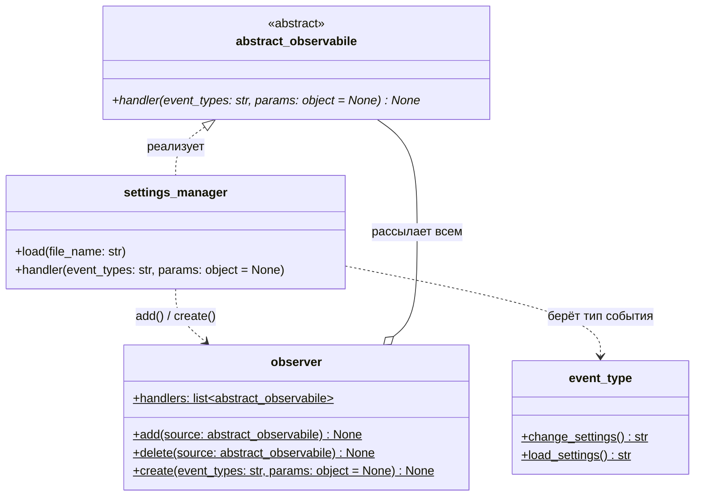

А вот как там идёт вызов во время `settings_manager.load()`:

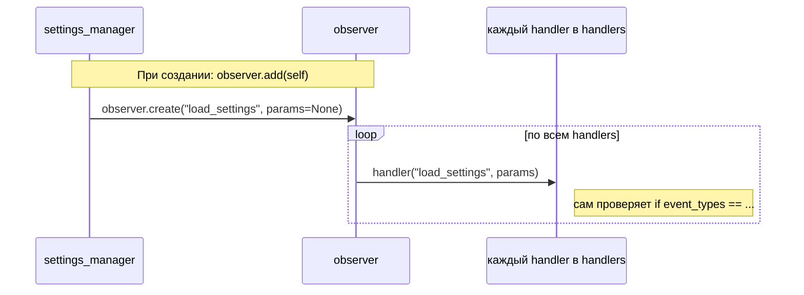

**Ключевые особенности этого каркаса:**
- `observer` выступает общим **диспетчером** (шиной событий): сам хранит список подписчиков `handlers` и рассылает событие всем, кто подписан.
- Источник события **не знает**, кто именно его слушает — просто дёргает `observer.create(тип_события, данные)`.
- Каждый подписчик реализует `abstract_observabile` и сам решает внутри `handler(...)`, на какие события реагировать. *(У преподавателя `settings_manager` в примере одновременно и источник, и подписчик — просто чтобы показать работу без других классов.)*

Теперь, глядя на эту схему, как ты бы выстроил нашу цепочку **источники событий → наблюдатель → хранение/запись логов (память + файл)**:
- какие классы будут **подписчиками**;
- что полетит в `event_type` и `params`;
- и не нужно ли нам что-то улучшить по сравнению со статическим `observer.handlers` (например, с оглядкой на тесты)?

---

### Студент · 26.11.2026 13:23

Смотри, как я себе это представляю. Получается, из, допустим, какого-нибудь API метода мы должны будем сказать обсерверу Привет, у нас вот такое событие создалась, там такая-то сущность. Мы должны там передать какие-то параметры, передадим event type. Соответственно, обсервер должен иметь в подписчиках логер-менеджер. Логер-менеджер в свою очередь в хендлере должен реализовать, получается, соответственно, хендлер для вот этого event type, что у нас что-то создано, и логер должен у себя это записать правильно. Вот как я это понял.

---

### ИИ-тренер · 26.11.2026 13:23

Ты точно уловил главную идею Наблюдателя — **развязку**: источник события просто кричит в `Observer`, и ему всё равно, кто его слушает.

Вот твоя схема сейчас:

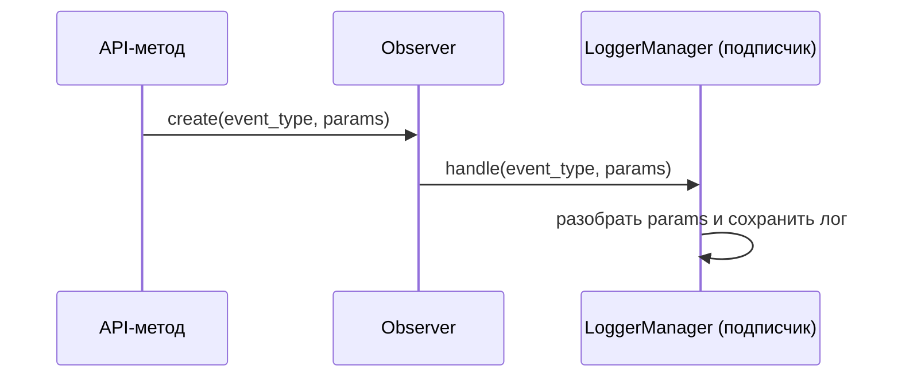

**Что работает хорошо:**
- Источники событий не зависят от `LoggerManager` (никаких лишних импортов и жёсткой связности).
- Если позже на то же событие «рецепт изменён» подпишется ещё и пересборка составных карт (у тебя это даже записано в `Docs/.notes.md`) — источник события менять не придётся.

Теперь проверим твою схему на **двух сценариях**, где вылезут проблемы:

1. **Откуда летит событие: API vs сервисы/менеджеры.**
   Ты упомянул: *«из API-метода сказать обсерверу, что создалась сущность»*.
   А что произойдёт, если `EntityService.create(...)` или `StorageManager.add_transaction(...)` вызовут не через HTTP, а из кода/теста/другого сервиса (для складских операций вообще нет CRUD-ручки)? И как тогда развести **«вызов Web-метода»** и **«CRUD-операцию»**?

2. **«Чёрный ящик» в `params` и запись в несколько мест.**
   - Если у нас ~10 разных `EventType` и каждый источник суёт в `params: object` что-то своё (кто словарь, кто строку, кто модель), во что превратится `LoggerManager.handle(...)`?
   - И если логи нужно писать **одновременно в память** (для API) **и в файл** (для отчёта в PR) — ты бы зашил запись в файл прямо внутрь `LoggerManager`, или разделил бы их (и как)?

Подумай над этими двумя точками — как бы ты их поправил?

---

### Студент · 26.11.2026 13:26

В первом же случае, мы, когда будем вызывать какое-то событие, мы должны передать систему, в которой было вызвано это событие.

Второй вопрос с параметрами я не понимаю. Объясни подробнее.

---

### ИИ-тренер · 26.11.2026 13:26

Хорошо, давай разберу проблему с `params: object` на **другом примере** — представь интернет-магазин, где есть заказы, оплата и доставка, и общий подписчик-аудитор.

### Что происходит, когда `params` — это просто `object`

Каждый сервис шлёт в `Observer` то, что ему удобно:

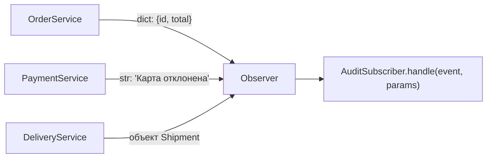

Тогда внутри `handle(...)` подписчика появляется вот такой «зоопарк»:

```python
def handle(self, event_type: str, params: object = None) -> None:
    if event_type == "order_created":
        # приходится знать, что тут dict и какие у него ключи
        text = f"Заказ {params['id']} на {params['total']}"
    elif event_type == "payment_failed":
        # а тут внезапно пришла просто строка
        text = f"Ошибка оплаты: {params}"
    elif event_type == "shipped":
        # а тут вообще модель со своими полями
        text = f"Отгрузка {params.track_code}"
```

**Чем это плохо:**
- **Хрупкость и `basedpyright`**: `params` имеет тип `object` — проверка типов не видит ошибок в ключах/атрибутах, баги вылезают только при запуске.
- **Нарушение Open/Closed (OCP)**: добавили 11-е событие в магазине — приходится лезть в подписчик и дописывать ещё один `elif`.
- **Непонятно, кто отвечает за текст и уровень**: откуда подписчику знать, это `INFO`, `DEBUG` или `ERROR`, и какое сообщение вывести?

### Как это лечится единым контрактом

Вместо «чего угодно» все издатели шлют в `Observer` объект **одного понятного формата** (например, в магазине — `StoreEvent(section, level, message, data)`). Тогда подписчик-аудитор вообще не пишет `if/elif` под каждое событие — он просто читает поля этого контракта. А если появится другой подписчик (скажем, «при создании заказа отправить SMS»), он проверит `event_type` и достанет детали из `data`.

---

Теперь перенесём это на **нашу** задачу:
1. Какой единый объект (контракт) ты бы передавал в `Observer` при вызове события в «Ромашке», и какие поля в нём будут?
2. По первой части ты верно заметил про передачу подсистемы — а **в каком слое** будут вызываться события: CRUD в `EntityService`, склад в `StorageManager`, настройки в `SettingsManager`, Web в FastAPI?

---

### Студент · 26.11.2026 13:29

Ну, в App Server нам получается нужно передавать модель самого нашего логера, то есть нам же нужно знать все данные, которые у нас нужны для записи в логер.

---

### ИИ-тренер · 26.11.2026 13:29

Идея понятная и сразу решает проблему с «зоопарком»:

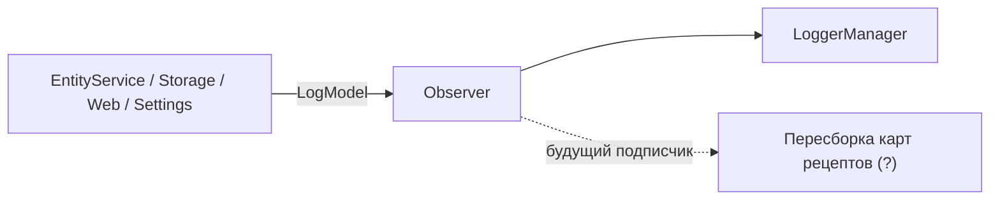

**Что в таком решении работает отлично:**
- Никаких `if/elif` и гадания по словарям внутри логгера — строгие типы, `basedpyright` доволен.
- Источник сам знает свой уровень (`INFO`/`ERROR`/`DEBUG`), подсистему и текст сообщения.
- Добавится новая подсистема (например, «Финансы» из ТЗ) — код логгера менять не придётся (соблюдён OCP).

**Но проверь это на одном сценарии из твоего же проекта:**
В `Docs/DomainEntities.md` и `Docs/.notes.md` уже запланирован второй наблюдатель: *при изменении карты полуфабриката пересобирать все составные карты, куда он входит*.

Представь: `EntityService.put` изменил рецепт «Бульон» и кинул в `Observer` объект `LogModel(period, CRUD, INFO, "Обновлён рецепт Бульон")`.
- Сможет ли второй подписчик (пересборка карт) узнать, **какой именно `RecipeModel`** изменился, если в событие попала только текстовая `LogModel`?
- И ещё момент: если `EntityService` сам конструирует `LogModel`, получается, что бизнес-сервис напрямую зависит от модели лога — устраивает ли тебя такой компромисс, или хочется развязать их сильнее?

Как бы ты доработал то, что летит в `Observer`?

---

### Студент · 26.11.2026 13:31

Ну, я понял, что вот этот контракт на передачу должен быть более общим, но я не могу понять и сообразить, какие поля у него должны быть.

---

### ИИ-тренер · 26.11.2026 13:31

Отлично, ты прямо нащупал нужную границу. Подскажу идею через **концепцию «Конверта события»** на примере банковского приложения.

В любом событии есть две части:
- **Шапка (метаданные)** — одинаковая для *всех* событий: что за событие, когда, откуда, насколько важно, краткое описание.
- **Содержимое (`payload` / `data`)** — сам объект, с которым это произошло (может быть `None`, если детали не нужны).

Посмотри, как два разных подписчика в банке читают один и тот же конверт:

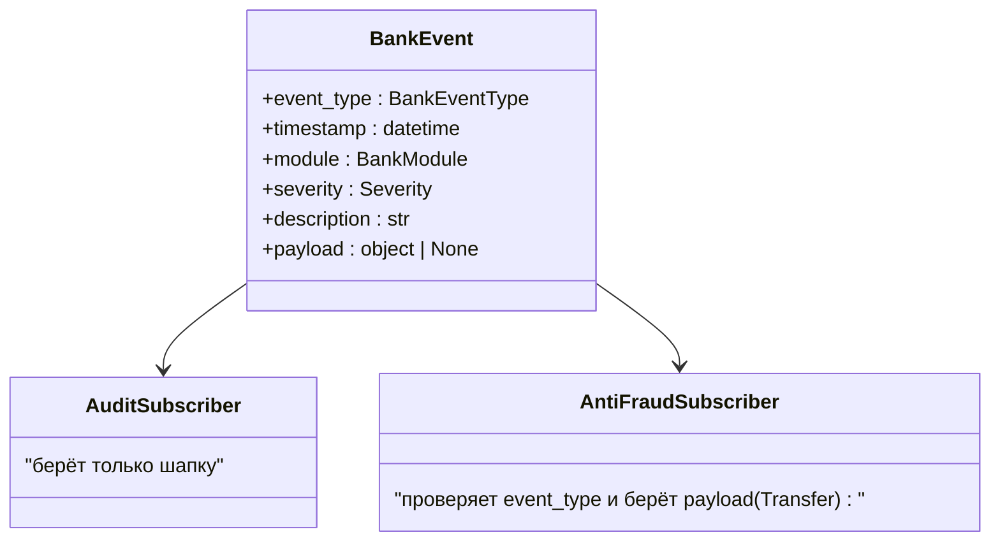

- **Аудиту** вообще не нужен `payload` и не нужны `if/elif` — он берёт готовые поля из шапки и записывает в журнал.
- **Антифроду** нужен конкретный объект `Transfer` — он проверяет `if event.event_type == TRANSFER_CREATED` и достаёт его из `payload`.
- При этом `TransferService` вообще не знает ни про аудит, ни про антифрод — он просто отправляет факт события.

---

Попробуй перенести эту идею на **«Ромашку»**:
Какие поля ты бы положил в наш общий объект события (и какие из них обязательны, а какие с умолчаниями — например, `period` / `payload`), чтобы из него легко собиралась твоя `LogModel` и при этом хватало данных будущему наблюдателю за рецептами?

---

### Студент · 26.11.2026 13:33

Так, ну если переносить на наше приложение, то нам нужен был бы event type, который был бы NAM классом. Нужен timestamp, чтобы знать, когда произошло. Нужно описание модуля. Это опять же описание условно подсистемы, из которой потом формируется блог. И да, нужен какой-то дата или payload, из которого можно будет уже потом детали какие-то доставать, обрабатывать.

---

### ИИ-тренер · 26.11.2026 13:33

Круто, каркас события уже почти сложился! Сравни его поля с полями твоей `LogModel`:

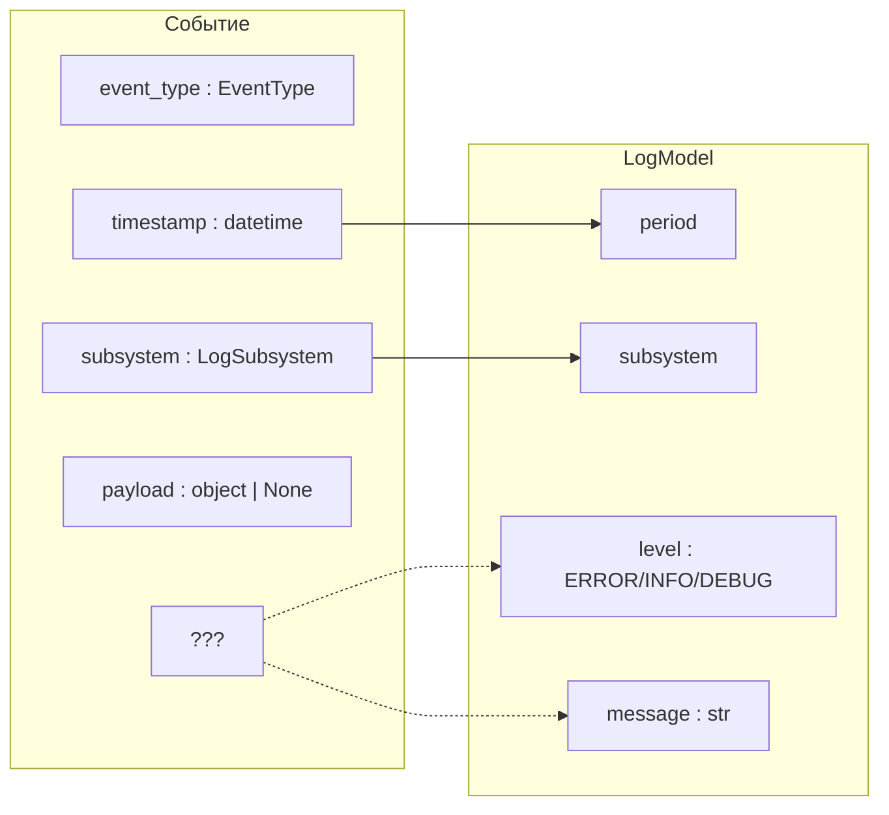

Два поля `LogModel` пока висят в воздухе: **`level`** и **`message`**.
Откуда подписчик-логгер должен их брать — добавить их прямо в событие (например, с умолчаниями вроде `level=INFO` и `timestamp=now`) или вычислять внутри логгера по `event_type` и `payload`? И почему?

 добавим поля `level` и `message` в событие, тогда `LoggerManager` не придется зависеть от структуры `payload` и городить `if/elif` для каждого `event_type`. Значения по умолчанию (`INFO` и `datetime.now()`) тоже удобны — при вызове события не придется писать лишний шаблонный код.
 
Теперь давай подумаем над тем, что ты спрашивал раньше:
- Кто именно и где будет вызывать события?
- Как разделить хранение в памяти и запись в файл?
- Как сделать `Observer` удобным для тестов (чтобы подписчики одного теста не протекали в другой)?
 
По первому:
- CRUD: в `EntityService` (create, put, patch, delete)
- Складские операции: в `StorageManager` (`add_transaction`)
- Настройки: в `SettingsManager` (`load` — и если добавим изменение настроек, то там тоже)
- Web-методы: в `Src/main.py` через FastAPI middleware, чтобы логировать каждый HTTP-запрос (метод, путь, статус, ошибки) в одном месте, а не копипастить в каждый эндпоинт.
 
Что скажешь по такой раскладке? И как лучше развести хранение в памяти, запись в файл и сброс `Observer` в тестах?

---

### Студент · 26.11.2026 13:36

Так, ну левел и месседж тоже нужно добавлять в модель события.Ну, пока думать о записи файл и хранении в памяти, прям как о отдельных процессах, я не вижу особого смысла. Я бы сделал так, что все записывается через логер-менеджер. И, если что, логер-менеджер имеет метод для того, чтобы там сохранить все файл.

---

### ИИ-тренер · 26.11.2026 13:36

Принято — с учётом YAGNI это разумное решение, и оно не закрывает дорогу на будущее: если позже понадобится писать в файл *на лету* или в SQLite, благодаря Наблюдателю можно будет просто подключить второго подписчика, не трогая ни `LoggerManager`, ни источники событий.

Вот итоговое ядро, которое у тебя сложилось, и его роли в паттерне **Наблюдатель**:

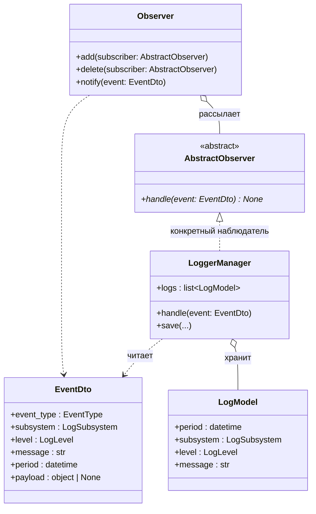

- **Издатели** (`EntityService`, `StorageManager`, `SettingsManager`, Web-слой) — публикуют `EventDto` в `Observer`.
- **Шина / Subject** (`Observer`) — ведёт список подписчиков и рассылает им событие.
- **Абстрактный наблюдатель** (`AbstractObserver`) — задаёт единый контракт `handle(event)`.
- **Конкретный наблюдатель** (`LoggerManager`) — превращает `EventDto` в `LogModel` и хранит записи.

---

Перед тем как переходить к реализации, давай закроем один важный пробел по источникам событий.
В `Docs/.homework.md` нужно логировать **«Изменение параметров настроек»**. Сейчас `SettingsManager` умеет только загружать настройки (`load()`), а отдельные поля меняются через сеттеры `SettingsModel`.

**Вопрос:** где и как ты хочешь ловить изменение параметров настроек — прямо в сеттерах `SettingsModel`, через отдельный метод изменения в `SettingsManager` (возможно, с сохранением в файл и/или API-ручкой), или только при `load()`?

---

### Студент · 26.11.2026 13:40

Думаю, что ловить изменение параметров настроек нужно на уровне сеттингс менеджера через какой-нибудь метод, а уже если когда-то появится какая-нибудь оперучка, то эта аперучка сама должна слогировать, что попытались изменить какую-то настройку настроек модели и потом уже сеттингс менеджер должен сказать там тоже залогировать изменилось не изменилось то есть чтобы можно было сопоставлять всю цепочку действий

---

### ИИ-тренер · 26.11.2026 13:40

Отличное решение — так `SettingsModel` остаётся чистой моделью данных без зависимости от `Observer`, а в логе видна полная цепочка: пришёл Web-запрос → `SettingsManager` применил или отклонил изменение.

Осталась последняя архитектурная развилка перед тем, как начнём писать код — **выдача логов через API** (из `_docs/20261123.md`):

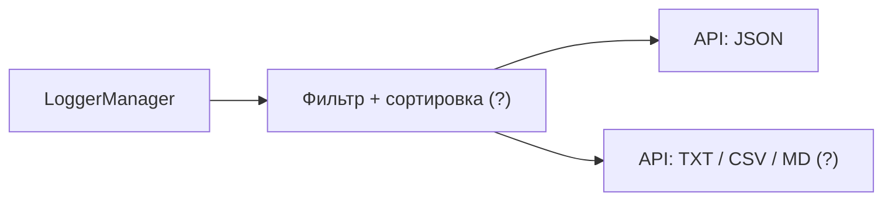

Два факта из твоего текущего кода, которые тут важны:
- Фильтрацию любого списка моделей уже умеет `Prototype`, а перевод в JSON — `ConverterFactory`. Сортировки пока нет.
- Существующие отчёты (`AbstractReport`) рассчитаны на **одну** `NamedEntity`, плюс там `TXT` отдаётся текстом, а `MARKDOWN` — файлом. В задании по логам наоборот: **таблица из списка записей**, где `TXT` и `CSV` — **файлом на скачивание**, а `MARKDOWN` — **текстом в браузере**.

Как ты видишь структуру этой части:
1. Кто отвечает за выборку (фильтр + сортировка) и за экспорт логов в `TXT / CSV / MARKDOWN`?
2. Какие маршруты и параметры запроса ты бы сделал в API?

---

### Студент · 26.11.2026 13:42

Предложи свои варианты по тому, как можно реализовать сортировку.

---

### ИИ-тренер · 26.11.2026 13:42

Вот три основных подхода к сортировке в нашем проекте — с их компромиссами:

| Подход | Как устроен | Что упрощается | Что усложняется / минусы | Когда выбирать |
|---|---|---|---|---|
| **А. Специализированная сортировка для логов** | `SortOrder` (`ASC`/`DESC`) + `LogSortField` (Enum: `period`, `subsystem`, `level`, `message`) в `LogService` / `LoggerManager` со словарём ключей | Максимально просто (KISS), строгие типы, в Swagger сразу выпадающий список полей, `datetime` и `LogLevel` сравниваются точно как нужно | Работает только для `LogModel` — если позже понадобится сортировка в `/api/filter/{entity_type}`, придётся делать заново | Если сортировка нужна только логам и важна простота |
| **Б. Универсальный `Sorter` поверх `FieldPathReader`** | Отдельный класс `Sorter` + `SortDto(field_name, direction)` (или список `SortDto`), работает с любыми моделями, как твой `Prototype` | Переиспользуется для любых моделей и будущих таблиц, единый стиль с `FilterDto` и `Prototype`, легко поддержать сортировку по нескольким полям | Нужно обработать крайние случаи: `None`, коллекция в пути (нельзя сортировать по списку), несравнимые типы; в Swagger поле — строка, а не фиксированный Enum | Если хочется «наперёд» в духе твоего `Prototype` |
| **В. Паттерн «Стратегия»** | `AbstractSortStrategy` + отдельный класс стратегии под каждое правило (`PeriodSort`, `SeveritySort`, …) | Легко делать нестандартное сравнение (например, `DEBUG < INFO < ERROR` по серьёзности, а не по алфавиту) | Избыточно много классов ради простого `sorted(..., key=...)` — для 4 полей это оверинжиниринг | Когда правил сортировки много и они со сложной бизнес-логикой |

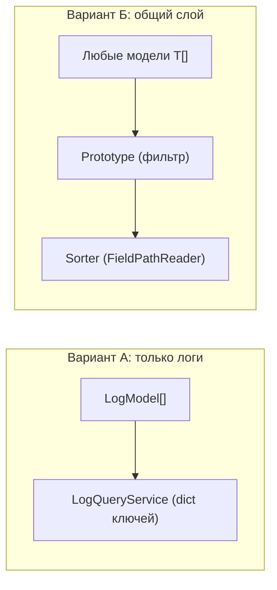

*(Отдельный нюанс для любого варианта: если сортировать по `level` как по строкам, порядок будет `DEBUG → ERROR → INFO` по алфавиту, а по важности — `DEBUG → INFO → ERROR`. Стоит сразу решить, какой порядок ожидаешь.)*

Какой вариант тебе ближе для проекта — и заодно, как ты видишь **экспорт логов в `TXT / CSV / MARKDOWN`**?

---

### Студент · 26.11.2026 13:45

Но я так понимаю, что надо писать какой-то отдельный сортер, потому что в будущем сортировка может понадобиться и в других местах. Насчет экспорта логов, не знаю, надо еще подумать, сравнить какие-то подходы.

---

### ИИ-тренер · 26.11.2026 13:45

Отличный выбор — отдельный `Sorter` поверх `FieldPathReader` идеально ложится рядом с `Prototype` и пригодится в будущих разделах ТЗ.

По экспорту логов (`TXT / CSV / MARKDOWN`) подскажу, на что опереться, когда будешь думать:
- `ReportResult` уже готов к переиспользованию — он сам решает, отдавать файл или текст, по флагу `is_binary` и методу `to_response(...)`.
- Главная развилка здесь: **встраивать список логов в существующие `AbstractReport`** (которые ждут одну `NamedEntity` и имеют другие флаги `is_binary` для `TXT`/`MARKDOWN`) **или сделать отдельный небольшой форматтер/фабрику для табличного экспорта логов** (а если захочешь — потом сравним варианты подробнее).

Как тебе удобнее двигаться дальше:
1. Сначала продумаем и сравним варианты экспорта логов прямо сейчас?
2. Или **зафиксируем ядро и пойдём кодить его по шагам** (`LogLevel` / `LogSubsystem` / `LogModel` → `EventType` / `EventDto` / `Observer` → `LoggerManager`), а к сортировке и экспорту вернёмся, когда само логирование уже будет работать?

*(Если хочешь обзор вариантов по экспорту — просто скажи, сравню их так же, как по сортировке.)*

---

### Студент · 26.11.2026 13:46

Давай сначала продумаем, сравним варианты экспорта, а потом уже все зафиксируем.

---

### ИИ-тренер · 26.11.2026 13:46

Посмотрел твои `CsvReport` и `TxtReport`: они разворачивают **дерево полей одной `NamedEntity`** (`field;value`), тогда как лог — это **плоская таблица строк** (`Период | Подсистема | Тип | Сообщение`) и с обратными правилами скачивания (`TXT` и `CSV` — файлом, `MARKDOWN` — текстом).

Все варианты переиспользуют твой готовый `ReportResult`. Вот сравнение:

| Вариант | Как устроен | Что упрощается | Что усложняется / риски | Когда выбирать |
|---|---|---|---|---|
| **1. Отдельные отчёты для логов + фабрика** | `AbstractLogReport` + `LogReportFactory` + 3 класса (`LogTxtReport`, `LogCsvReport`, `LogMarkdownReport`), вход — `list[LogModel]` | Привычный стиль проекта (как `ReportFactory`), не трогает старые отчёты, новый формат — 1 класс + 1 строка в словаре, легко настроить `utf-8-sig` и `;` для Excel | Работает только с `LogModel`; если завтра понадобится выгружать в CSV/MD ту же ОСВ (`TurnoverReport`) — придётся дублировать форматирование таблиц | Если важны простота и минимальный объём кода под задачу |
| **2. Универсальный табличный экспорт (`TableReport`)** | Общая `TableDto(headers, rows)` + `TableReportFactory` (`TXT`/`CSV`/`MD`) + маленький адаптер `LogModel[] → TableDto` | Таблицы CSV/TXT/MD пишутся один раз на весь проект (подойдут и для логов, и для ОСВ, и для будущих журналов/отчётов из ТЗ) | Появляется промежуточный `TableDto` и нужно отдельно задавать способ выдачи (`is_binary`) под конкретный сценарий (для логов `TXT`=файл, `MD`=текст) | Если проектируем «наперёд» под будущие табличные выгрузки |
| **3. Расширить существующие `AbstractReport`** | Добавить в текущие отчёты поддержку списка `LogModel` | Нет новой фабрики | **Сильный конфликт:** другой формат данных (дерево vs таблица), противоположные `is_binary` для `TXT` и `MD` (сломает старые тесты или появятся костыли), лишние форматы `XML`/`HTML` | Лучше избегать |

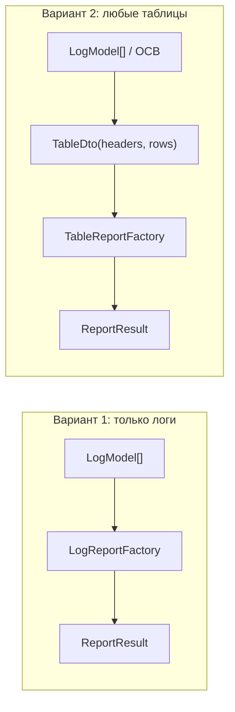

Какой вариант тебе больше подходит? После этого соберём финальную картину всей архитектуры и разобьём реализацию на понятные шаги.

---

### Студент · 26.11.2026 13:48

Мне больше нравится второй универсальный вариант, потому что, и правда, если в какой-то из моментов преподаватель запросит сделать отчет по ОСВ, а не просто какую-то не просто вернуть JSON, то со вторым вариантом это получится сделать гораздо быстрее и лучше.

---

### ИИ-тренер · 26.11.2026 13:48

Вся архитектура сложилась — чистая, расширяемая на будущее (под ОСВ, новые подсистемы из ТЗ и SQLite) и без лишнего нагромождения:

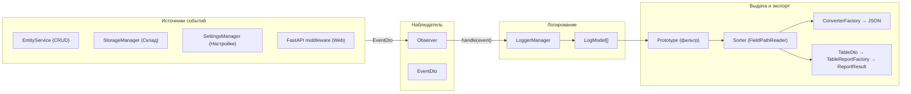

### План реализации по шагам

1. **Модели и перечисления:** `LogLevel`, `LogSubsystem`, `EventType`, `LogModel(BaseEntity)`, `EventDto` + юнит-тесты.
2. **Наблюдатель и `LoggerManager`:** `AbstractObserver`, `Observer`, `LoggerManager` (подписка, хранение, сохранение в файл) + юнит-тесты.
3. **Подключение источников событий:** `EntityService`, `StorageManager` (`add_transaction`), `SettingsManager` (`load` + метод изменения настроек), FastAPI middleware.
4. **Универсальная сортировка:** `SortOrder`, `SortDto`, `Sorter` поверх `FieldPathReader` + юнит-тесты.
5. **Табличный экспорт:** `TableDto`, `AbstractTableReport` + `TableReportFactory` (`TXT`, `CSV`, `MARKDOWN`) → `ReportResult` + юнит-тесты.
6. **API, Swagger и артефакты для PR:** маршруты чтения/выгрузки логов в `Src/main.py`, интеграционные тесты, обновление `Docs/openapi.yaml` и `Docs/ClassDiagram.md`, файлы/скрины логов.

---

Короткий вопрос перед стартом, глядя на твой `Tst/conftest.py`:
Если сделать `Observer` со статическим списком `handlers = []` (как в примере преподавателя), а `conftest.py` между тестами сбрасывает только наследников `AbstractManager`, **что пойдёт не так во втором и третьем тесте?**

Как ответишь — можем сразу переходить к **Шагу 1**: пиши модели и перечисления, а я помогу, если где-то застрянешь, и разберём код!

---
